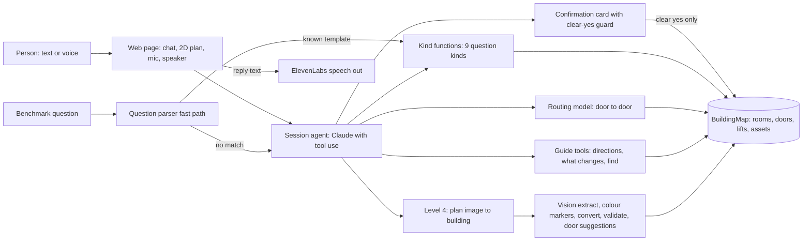

# Talk to Your Building: technical explanation

Track 01 entry. Run instructions: `BENCHMARK.md`. Index of all submission documents: `docs/submission/README.md`.

## Idea

Every fact comes from deterministic Python. The LLM does not compute: it picks tools, asks only what is missing, shows what it understood, and words the reply. A wrong sentence can therefore only come from a wrong tool call, and tool calls are tested.

## Architecture

- **Question parser fast path** (`building_agent/question_parser.py`): the published benchmark sentences follow fixed templates. If the whole sentence matches and every name resolves uniquely, a kind function answers with no LLM call. Anything else goes to the agent.
- **Kind functions** (`building_agent/kinds/`): one file per question kind, each tested against the labelled answers.
- **Routing** (`building_agent/routing.py`): one graph node per door and connector, straight distance between doors inside a room, stairs 2 m per metre of height, lift 15 m plus 1 m per metre (the organisers' scoring note). Kit-labelled numbers (errand, what_if_door) stay on the kit model because the labels come from it.
- **Session agent** (`building_agent/agent.py`, `guide_tools.py`): keeps the conversation and the building state. Tools: find (rooms, assets, lifts), route, step-by-step directions with landmarks (3 steps per turn, "next", "repeat"), forklift route, "what changes" for a closure, edit proposals.
- **Confirmation card**: every change (close, add or remove door, widen door, move asset) first shows a card with the effect on the current route. `confirm_change` refuses unless the person's own reply, in a later message, is a clear yes.
- **Web page** (`web/`): 2D plan with animated route, closures, doors, find hits that pulse, chat, mic button, speaker.
- **Voice**: speech in via the browser (Web Speech API), speech out via ElevenLabs `eleven_flash_v2_5`. The key stays on the server.
- **Level 4** (`building_agent/level4/`): Claude vision reads a floor plan, a deterministic colour detector finds door, opening and entrance markers, the converter snaps doors to walls and entrances to the outer wall, the validator flags rooms with no way out, door suggestions are proposals only. Nothing is saved without the card and a clear yes.

## Stack

Python 3.12+ with uv, shapely, networkx, Claude API with tool use (Sonnet 5.5 for plan reading), stdlib `http.server`, plain JS and SVG (no build step), ElevenLabs text to speech, pytest, ruff.

## What we measured

All numbers come from files in this repo. "Estimate" means we scored against our own reimplementation of the organisers' rule, not their scorer.

| Measure | Result | Source |
|---|---|---|
| Dev sample, agent end to end | 72 of 72 | `docs/HANDOFF.md` |
| Warm-up questions, tools alone | 369 of 369 | `docs/HANDOFF.md`, `docs/STATUS.md` |
| Warm-up, agent, mixed set | 18 of 18 | `docs/STATUS.md` |
| Closures (assume_closed) | 26 of 29 | `docs/STATUS.md` |
| Live conversation tests | 22 of 22 | `docs/HANDOFF.md` |
| Run on `data/test` | 24 of 24 formally valid (old routing model, correctness is not scored there) | `docs/HANDOFF.md` |
| Route sequences at full points, kit model | 92.4 % of 672 cases (estimate) | `docs/specs/route-metric-spike.md` |
| Route sequences at full points, door to door | 99.6 % of the same cases (estimate, spike prototype) | `docs/specs/route-metric-spike.md` |
| Level 4, 5 clean floors | recall 1.00, precision 1.00, door recall 1.00, median area error 0.6 % | `docs/eval-log.md` |
| Level 4, 2 Swiss floors | median recall 0.79, median door recall 0.31 | `docs/eval-log.md` |
| Level 4, 1 OSM floor | recall 0.86, door recall 0.74 with markers | `docs/eval-log.md` |
| Level 4 cost and time | median 10.9 s and 0.023 USD per floor (list price, not checked against an invoice) | `docs/eval-log.md` |
| Colour marker detection, 117 dev floors | door recall 0.98 to 1.00, precision 1.00 | `docs/eval-log.md` |
| Door suggestions, simulated gaps | rooms with a way out 46 % to 100 %, suggestion precision 83 % | `docs/eval-log.md` |
| Entrance fix, factory plan | invalid route sequences 108 to 0 | `docs/eval-log.md` |

## Limits

- Level 4 is strong on clean plans with printed room numbers. On dense Swiss and OSM plans it misses rooms and doors. The agent warns about unreachable rooms and proposes doors, a person confirms. Route quality stays low there: 6 % and 3 % of room pairs at full points on the two Swiss floors (`docs/eval-log.md`).
- The plans carry no scale bar, so the agent asks for one known length. A wrong scale makes all lengths wrong, the graph stays right.
- The data has no windows, so there is nothing to answer or draw about them.
- Forklift rules (aisles and openings of 3 m or wider) follow the data but are only roughly tested.
- Nothing in the data links buildings, so the campus format (Level 3) is our own invention (`docs/specs/level3-campus.md`).
- Route numbers are against our own reading of the scoring note. Open questions for the organisers: `docs/SYNERA_QUESTIONS.md`.

## How we tested

- Tests are the contract: each question kind has a test against labelled answers. No merge without `scripts/check.sh` green (format, lint, tests, no API key needed).
- A sweep runs every question kind on all 280 buildings. It found a real crash (empty wall line in `what_if_door`).
- Live conversation scripts with tricky users: vague question, wrong room, change of mind, wheelchair user, hands full, facility manager (`docs/specs/interaction-scripts.md`).
- Adversarial variants: terse "just do it", typos, topic switch between card and yes, double yes, "yes, but not lift 1". A change never happens without a clear yes.
- `scripts/preflight.py` checks an unseen building in seconds.
