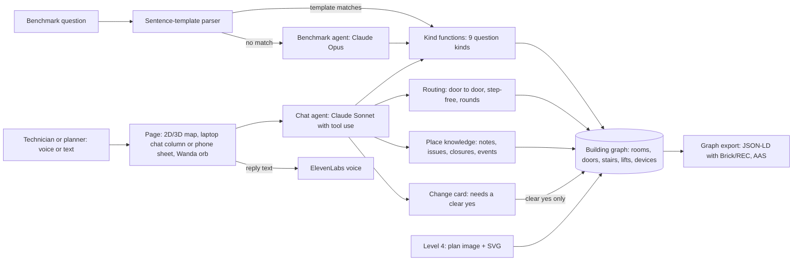

# Wanda – the building that talks back: technical explanation

Track 01 entry, state of `main` at 168f0b9 (Sunday 25.10.2026). Run instructions: `SUBMISSION/BENCHMARK.md`.
Short version for the form: `docs/submission/FORM_TECH_TEXT.md`.

## Idea

Facts from code. Language from the model. Every number, room and route comes from deterministic Python; Claude picks
tools, asks what is missing and phrases the reply. A wrong sentence can only come from a wrong tool call, and the
tools are tested against the labelled answers.

## Architecture

- **Core** (`building_agent/`): one file per question kind in `kinds/`. Routes on the kit 1.1.0 model: door to door,
  15 cm wall clearance, stairs 2 m per metre climbed, a lift 15 m per ride plus 1 m per metre (`routing.py`).
- **Parser fast path** (`question_parser.py`): if a whole benchmark sentence matches a template and every name
  resolves, a kind function answers with no API call. All 145 test questions take this path.
- **Two models** (`agent.py`): the page chat runs on Sonnet (`CHAT_MODEL`, medium effort) so voice replies come fast.
  Benchmark questions that miss a template go to the starter's Opus (`MODEL`).
- **Changes**: closing a lift, adding or widening a door, moving a device first shows a card with the effect on the
  current route. `confirm_change` refuses unless the person's own later message is a clear yes.

## New since Saturday

- **Place knowledge with time** (`knowledge.py`, `knowledge_tools.py`): notes, issues and closures anchored at a room,
  device, door or lift, with author, photo, valid-from and valid-to. "Fixed" supersedes a fact instead of deleting it.
  A timed closure ("lift 1 is out until tomorrow") reroutes until it expires, checked at the start of every request.
- **Events and room bookings** (`docs/specs/events.md`): the same store holds sessions and bookings. `find_events`
  answers "where are the pitches?", `room_free` answers "is the Project Room free at 10:00?".
- **Knowledge graph per room** (`knowledge_export.py`, `twin/src/ui/KnowledgeGraph.tsx`): the room card on the laptop
  opens the room's graph with Brick Schema and RealEstateCore types; "Export as AAS" downloads an Asset Administration
  Shell view of the machines (`GET /api/graph?format=aas`).
- **Inspection rounds** (`round_tools.py`): "all fire extinguishers on the ground floor" becomes the shortest order,
  one stop per device, legs measured device to device (exact for up to 8 devices, else nearest neighbour plus 2-opt).
  At each stop Wanda reads the notes left there; "finished" shows a job report (`twin/src/ui/Report.tsx`).
- **Step-free mode**: "I'm in a wheelchair" sets a flag, and every later route in the session avoids stairs.
- **Walk with me** (`twin/src/walkWithMe.ts`): the phone counts steps and moves an estimated dot along the route.
- **Page** (`twin/`, React and three.js): on the laptop the chat is a fixed column on the left; on the phone one sheet
  at a time. The Wanda orb is the one voice control: tap to talk, tap to stop her. While guiding, Chrome also listens
  for "Hey Wanda" (tap the orb to mute it); Safari on iOS has no reliable continuous recognition, so there you tap.
  Speech in through the browser, speech out through ElevenLabs `eleven_flash_v2_5` (key stays on the server).
- **Level 4** (`building_agent/level4/`): reads the plan SVG and scale, storey heights, floor alignment over stairs and
  lifts, door widths estimated from opening kind and room types, room types and equipment from furniture symbols.
  Nothing is saved without the card and a clear yes.
- **Demo building** (`demo/buildings/plan-89323a15`): the Munich Urban Colab, read from photos of its evacuation plans
  on site. Two floors, 41 spaces, 15 fire extinguishers; doors added by hand because evacuation plans draw no widths.
  Scale checked against the venue's published sizes: Project Room 142 m² against 141 m².

Stack: Python 3.12, uv, shapely, networkx, Claude API, stdlib `http.server`, React, three.js, Vite, ElevenLabs.

## What we measured

| Measure | Result | Source |
|---|---|---|
| Test file `data/test` | 145 of 145 answered by template and kind code, no API call; file valid | parser over `data/test`, `submission --check` (Sunday) |
| Dev benchmark, full | 138 of 138 | `benchmark.evaluate data/dev`, team run this weekend (calls the API, not re-run) |
| Dev benchmark, 3 per kind | 24 of 24 | `--per-kind 3`, team run Sunday (not re-run) |
| Our routes vs the 1.1.0 labels (route, step-free, closure, tour) | 1338 of 1338 at full marks, worst length ratio 0.9991 | `scripts/eval_warmup.py data/train data/dev --routes`, re-run Sunday, no API |
| Kind tests against labelled answers | 868 of 868 | the 9 `tests/test_<kind>.py` files, part of the run below |
| Offline test suite | 5072 passed, 21 skipped, 0 failed (live and browser tests excluded) | `uv run pytest -q`, Sunday on 168f0b9, no API key, 10 min 49 s |
| Unseen-building pipeline | 14 of 14 | team run this weekend (not re-run) |
| Level 4 questions on buildings built from plans (20 dev buildings) | 191 of 238 (80 %), 83 % of the questions whose rooms were found | `scripts/level4_questions_eval.py --no-log`, Sunday, no API |
| Level 4 reading, 5 clean floors | recall 1.00, precision 1.00, door recall 1.00, area error 0.6 % | `docs/eval-log.md`, 24.10. |
| Urban Colab round, fire extinguishers ground floor | 8 stops, 98.4 m (name order 234.1 m) | `plan_round` on main, start Project Room |

## Limits

- Door widths are not in a plan, so Level 4 estimates them: wide-delivery questions on built buildings get 1 of 9.
  Swiss and OSM plans are weaker (67 % and 60 % in the run above).
- The Urban Colab has only the ground floor and floor 1 on `main`; floor 3, where the video is shot, is on
  `feat/mucl-all-floors`.
- No positioning hardware: the person says or taps where they are; "Walk with me" is an estimate.
- The live conversation suite (74 tests, real model) was not re-run for this document because it costs money.
