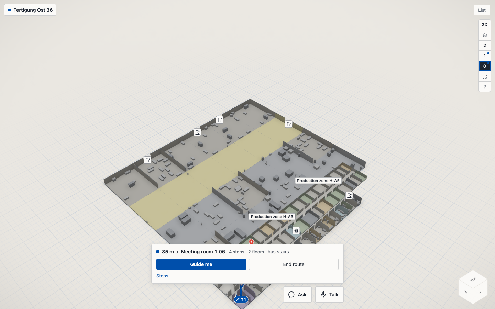
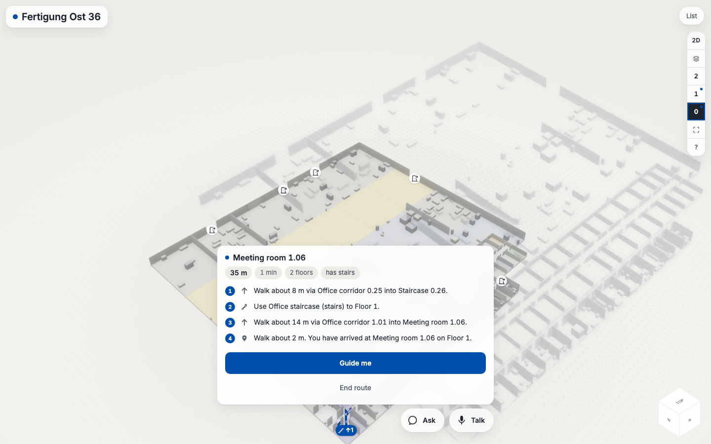
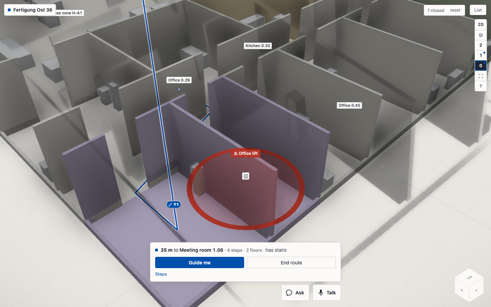
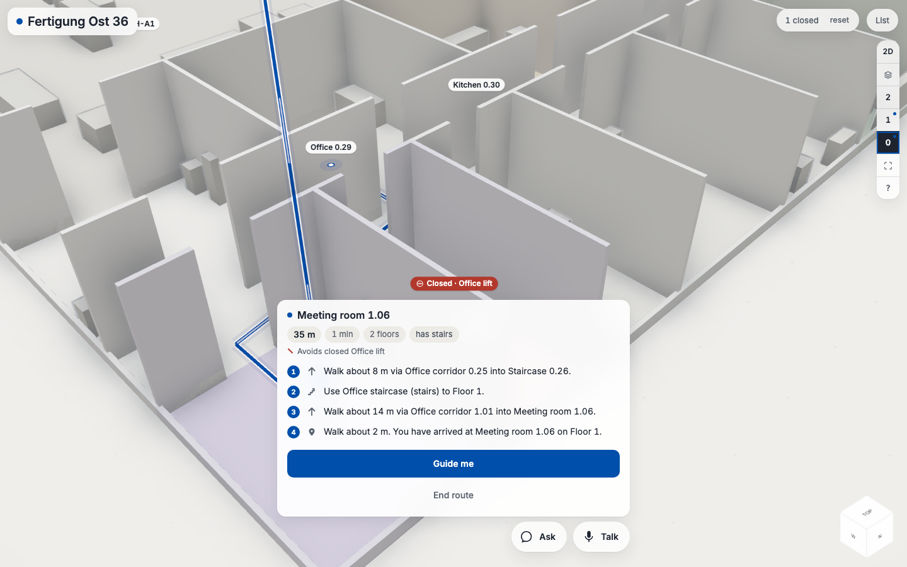
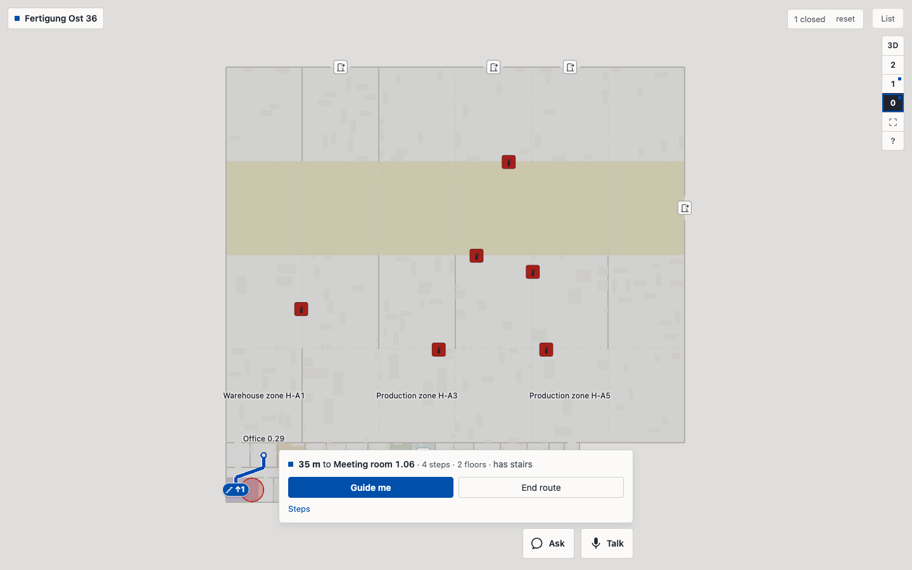
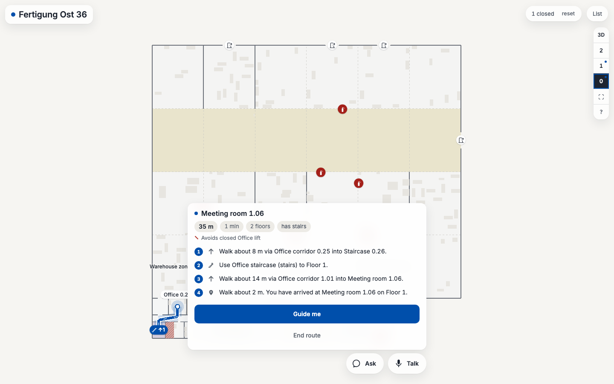
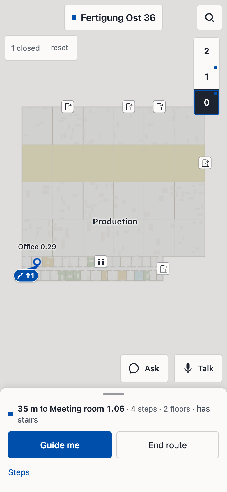
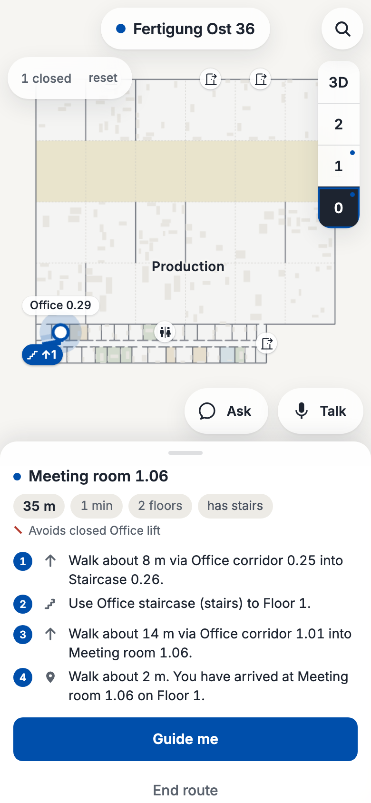

# UI polish: before and after

Screenshots from `scripts/ui_shots.py` (factory `proc-factory-dev-012`, route Office 0.29 to Meeting room 1.06,
Office lift closed). Before: `twin/docs/ui-before/`, after: `twin/docs/ui-after/`. Plan: `docs/specs/ui-polish.md`.

| View | Before | After |
|---|---|---|
| 3D overview with route (1440 x 900) |  |  |
| Closed lift (1440 x 900) |  |  |
| 2D plan (1440 x 900) |  |  |
| Phone with the route sheet (390 x 844) |  |  |

## What changed (five lines)
1. Chrome: every floating control is frosted glass with one layered shadow, pills and 10/14/18 px corners, no hairlines; Inter (self-hosted) with tabular numerals; the building name is a title.
2. Scene: near-white walls and slabs (tone mapping off, brighter daylight), furniture in the floor's tone, a calm gradient ground with a faint dot lattice instead of the blue CAD grid, neutral soft ambient occlusion.
3. Route: wider line with a white casing and a soft blue halo, white dashes travelling at walking pace, pulsing start and "you are here" halo, destination pin that pops; 2D plan enters north-up with crisp dark walls.
4. Labels and closures: pill labels (selected room in ink), round white POI chips, safety icons in their norm colours with white glyphs; a closed room is tinted red with a "Closed · name" badge, closed lifts and stairs keep the hatched slab and prohibition glyph from main plus a 3D badge.
5. Route card: destination name, fact chips (metres, minutes, floors, step-free), numbered steps with glyphs, full-width "Guide me", ghost "End route"; nothing truncated.

## Left undone
- A second line (type · area) under 3D room labels and a hatched fill for closed plain rooms (only the tint and outline).
- Labels do not fade out when they leave (React unmounts the node); they fade in.
- No dark theme (not wanted).
